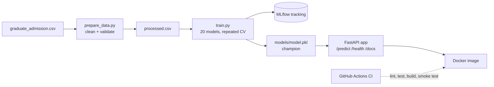

# Graduate Admission Prediction

End-to-end MLOps project: a reproducible training pipeline that compares 20
models, tracks every run in MLflow, serves the champion through a FastAPI
endpoint, and is tested, containerised and built by CI on every push.

**Task:** predict whether an applicant is admitted (Chance of Admit >= 0.75)
from seven academic features.

## Architecture



## Dataset

Graduate admissions data (Kaggle: melovi/uni-admission): 3,000 applicants
extending the original 400-record Graduate Admissions dataset (Mohan S.
Acharya). Seven features: GRE Score, TOEFL Score, University Rating, SOP,
LOR, CGPA, Research. After dropping the identifier column, the free-text
motivation letter, and one exact duplicate, 2,999 records remain, with no
missing values.

`Serial No.` is dropped because row order leaks the outcome: the first 400
rows are the original data, which has lower admission chances, so the ID alone
predicts the label. The `Chance of Admit` column is only used to build the
label (>= 0.75, about 79% admitted); it is never a model input.

The 2,600 added rows have a shifted target distribution compared with the
original 400 (higher chances, a weaker link to CGPA), so results should be
read as illustrative rather than as claims about real admissions. The dataset
has no time column.

## Quick start

Requires Python 3.12 and git.

```
git clone https://github.com/aleshbathegreat/mlops_project.git
cd mlops_project
git checkout milestone_1
python -m venv venv
venv\Scripts\activate
pip install -r requirements.txt

python src/prepare_data.py
python src/train.py
pytest tests/ -v
uvicorn src.app:app
```

Then open http://127.0.0.1:8000/docs. Training takes a few minutes and
creates `models/model.pkl` and `mlflow.db` locally; both are git-ignored.

To browse the experiments:

```
mlflow ui --backend-store-uri sqlite:///mlflow.db
```

## API

| Endpoint | Method | Purpose |
|---|---|---|
| `/health` | GET | Returns `{"status": "ok"}` |
| `/predict` | POST | Returns `admitted` (0/1) and `probability` |
| `/docs` | GET | Interactive documentation |

Example request body for `/predict`:

```json
{
  "gre": 320, "toefl": 110, "university_rating": 4,
  "sop": 4.0, "lor": 4.0, "cgpa": 9.0, "research": 1
}
```

Inputs are validated with Pydantic (for example GRE 260-340, CGPA 0-10).
Out-of-range or wrongly typed values return HTTP 422.


## Docker

```
docker build -t admission-api .
docker run -p 8000:8000 admission-api
```

The image prepares the data and trains the model during the build, so it does
not depend on any committed model file.

## Model comparison

20 configurations across 8 families (baselines, logistic regression, trees,
SVM, KNN, small neural network, ensembles). Each is evaluated with 5-fold
stratified cross-validation repeated 2 times (10 scores per model). The test
set (20% of the data) is scored once, for reporting only.

Because about 79% of applicants are admitted, accuracy and positive-class F1
are misleading: always predicting "admitted" scores an F1 of 0.885. Models are
therefore ranked by ROC-AUC, with balanced accuracy reported alongside, and
class weights are used for the models that support them.

**Selection rule:** the best full-feature model by mean CV ROC-AUC, then the
simplest model within one standard deviation of it. Baselines are reference
points and cannot be champions.

**Champion:** SVM with RBF kernel (C=10), CV ROC-AUC 0.958 (+/- 0.012),
test ROC-AUC 0.969, test balanced accuracy 0.906.

**Findings**

- Both dummy baselines score ROC-AUC 0.50, and every other model scores at
  least 0.90.
- The top six models are within about 0.007 AUC of each other, so their order
  is not meaningful; the simplest of them was chosen.
- On the original 400 records, a CGPA-only model matched every full model. On
  about 3,000 records, SVM, MLP and gradient boosting (0.95-0.96 AUC) clearly
  beat logistic regression (0.923) and CGPA alone (0.892): the best model type
  changes as the data grows.
- Caveat: 2,600 of the records were added to the original 400 and differ in
  distribution, so part of the gain may come from that shift.


## Tests and CI

`pytest` runs 7 tests covering the health and predict endpoints (valid,
wrong-type and out-of-range input), model loading, and data preparation
(valid output and rejection of bad data).

GitHub Actions runs on every push and pull request: Ruff lint and format
check, data preparation, training, the tests, then a Docker build with a
`/health` smoke test.


## Project structure

```
src/prepare_data.py   data cleaning and validation
src/train.py          20-model comparison, MLflow logging, champion selection
src/app.py            FastAPI service
tests/test_app.py     unit and endpoint tests
Dockerfile            container image
.github/workflows/    CI pipeline
```

## Limitations

- About 3,000 records is still small, and 2,600 of them were added to the
  original 400 with a different distribution; small differences between models
  should not be over-read.
- The classes are imbalanced (about 79% admitted), so metrics other than
  accuracy are used to compare models.
- The dataset has no time dimension, so behaviour under new data is studied
  by simulation rather than real arrivals.

## Team

See CONTRIBUTION.md. AI tool usage is documented in AI_USAGE.md.
