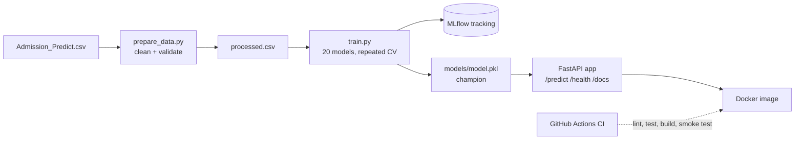

# Graduate Admission Prediction

End-to-end MLOps project: a reproducible training pipeline that compares 20
models, tracks every run in MLflow, serves the champion through a FastAPI
endpoint, and is tested, containerised and built by CI on every push.

**Task:** predict whether an applicant is admitted (Chance of Admit >= 0.75)
from seven academic features.

## Architecture



## Dataset

Graduate Admissions dataset (Mohan S. Acharya): 400 applicants, seven
features, no missing values. Features: GRE Score, TOEFL Score, University
Rating, SOP, LOR, CGPA, Research. The `Serial No.` column is dropped, and the
original `Chance of Admit` column is only used to build the label; it is never
a model input. The dataset has no time column.

## Quick start

Requires Python 3.12 and git.

```
git clone https://github.com/aleshbathegreat/mlops_project.git
cd mlops_project
git checkout milestone_1
python -m venv venv
venv\Scripts\activate
pip install -r requirements.txt

python src/prepare_data.py
python src/train.py
pytest tests/ -v
uvicorn src.app:app
```

Then open http://127.0.0.1:8000/docs. Training takes one to three minutes and
creates `models/model.pkl` and `mlflow.db` locally; both are git-ignored.

To browse the experiments:

```
mlflow ui --backend-store-uri sqlite:///mlflow.db
```

## API

| Endpoint | Method | Purpose |
|---|---|---|
| `/health` | GET | Returns `{"status": "ok"}` |
| `/predict` | POST | Returns `admitted` (0/1) and `probability` |
| `/docs` | GET | Interactive documentation |

Example request body for `/predict`:

```json
{
  "gre": 320, "toefl": 110, "university_rating": 4,
  "sop": 4.0, "lor": 4.0, "cgpa": 9.0, "research": 1
}
```

Inputs are validated with Pydantic (for example GRE 260-340, CGPA 0-10).
Out-of-range or wrongly typed values return HTTP 422.


## Docker

```
docker build -t admission-api .
docker run -p 8000:8000 admission-api
```

The image prepares the data and trains the model during the build, so it does
not depend on any committed model file.

## Model comparison

20 configurations across 8 families (baselines, logistic regression, trees,
SVM, KNN, small neural network, ensembles). Each is evaluated with 5-fold
stratified cross-validation repeated 3 times (15 scores per model). The test
set (20% of the data) is scored once, for reporting only.

**Selection rule:** the best full-feature model by mean CV F1, then the
simplest model within one standard deviation of it. Baselines are reference
points and cannot be champions.

**Champion:** logistic regression (C=10), CV F1 0.851 (+/- 0.037),
test F1 0.841, test ROC-AUC 0.954.

**Findings**

- Every real model scored 0.80-0.86 CV F1. A random guesser scored 0.41.
- The top ten models are within one standard deviation of each other, so
  their ranking is not meaningful on 400 records.
- A logistic regression on CGPA alone scored 0.857, level with the best
  full-feature model: most of the signal sits in a single feature.
- Test scores on 80 rows are noisy (two MLPs scored 0.90 and 0.72), which is
  why the champion is chosen on cross-validation and not on the test set.


## Tests and CI

`pytest` runs 7 tests covering the health and predict endpoints (valid,
wrong-type and out-of-range input), model loading, and data preparation
(valid output and rejection of bad data).

GitHub Actions runs on every push and pull request: Ruff lint and format
check, data preparation, training, the tests, then a Docker build with a
`/health` smoke test.


## Project structure

```
src/prepare_data.py   data cleaning and validation
src/train.py          20-model comparison, MLflow logging, champion selection
src/app.py            FastAPI service
tests/test_app.py     unit and endpoint tests
Dockerfile            container image
.github/workflows/    CI pipeline
```

## Limitations

- 400 records means noisy comparisons; small differences between models
  should not be over-read.
- The dataset has no time dimension, so behaviour under new data is studied
  by simulation rather than real arrivals.

## Team

See CONTRIBUTION.md. AI tool usage is documented in AI_USAGE.md.