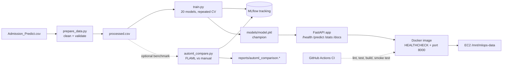

# Graduate Admission Prediction

End-to-end MLOps project: a reproducible training pipeline that compares 20
models, benchmarks bounded AutoML (`FLAML`) against manual champions, tracks
every run in MLflow, serves predictions and runtime metrics through a
containerized FastAPI service, and is verified by CI on every push.

**Task:** predict whether an applicant is admitted (`Chance of Admit >= 0.75`)
from seven academic features.

## Architecture



## Dataset

Graduate Admissions dataset (Mohan S. Acharya): 400 applicants, seven
features, no missing values. Features: `GRE Score`, `TOEFL Score`,
`University Rating`, `SOP`, `LOR`, `CGPA`, `Research`. The `Serial No.` column
is dropped, and `Chance of Admit` is only used to build the binary `target`
label (`>= 0.75`); it is never a model input. The dataset has no time column.

## Quick start

Requires Python 3.12 and `git`.

```bash
git clone https://github.com/aleshbathegreat/mlops_project.git
cd mlops_project
git checkout main
python3.12 -m venv venv
# Linux / macOS:
source venv/bin/activate
# Windows (PowerShell/CMD):
# venv\Scripts\activate
pip install -r requirements.txt

python src/prepare_data.py
python src/train.py
pytest tests/ -v
uvicorn src.app:app --host 0.0.0.0 --port 8000
```

Then open http://127.0.0.1:8000/docs. Training takes one to three minutes and
creates `models/model.pkl` and `mlflow.db` locally; both are git-ignored.

To browse MLflow experiments locally:

```bash
mlflow ui --backend-store-uri sqlite:///mlflow.db
```

To run the bounded AutoML vs. manual comparison on demand (20-second budget):

```bash
python src/automl_compare.py --time-budget 20
```

## API & Monitoring

| Endpoint | Method | Purpose |
|---|---|---|
| `/health` | GET | Liveness/readiness check; returns `{"status": "ok"}` |
| `/predict` | POST | Validates input with Pydantic and returns `admitted` (`0`/`1`) and `probability` |
| `/stats` | GET | Thread-safe service metrics: `total_requests`, `predict_requests`, `avg_latency_ms`, `uptime_seconds` |
| `/docs` | GET | Interactive Swagger / OpenAPI documentation |

Every HTTP request passes through thread-safe middleware (`threading.Lock` +
`time.perf_counter()`) that updates request counters, tracks average latency in
milliseconds, and logs structured lines (`METHOD PATH -> STATUS (LATENCY ms)`)
to stdout via the `admission_api` logger.

Inputs are validated with Pydantic (for example GRE `260-340`, TOEFL `0-120`,
CGPA `0-10`). Out-of-range or wrongly typed values return HTTP `422`.

### Ready-to-run `cURL` examples

Set `BASE_URL` to your EC2 public endpoint or local server:

```bash
export BASE_URL="http://<EC2_PUBLIC_IP>:8000"
# Or locally: export BASE_URL="http://127.0.0.1:8000"

# 1. Health check
curl -fsS "${BASE_URL}/health" && echo

# 2. Baseline monitoring stats
curl -fsS "${BASE_URL}/stats" && echo

# 3. Run a prediction
curl -fsS -X POST "${BASE_URL}/predict" \
  -H "Content-Type: application/json" \
  -d '{
    "gre": 320,
    "toefl": 110,
    "university_rating": 4,
    "sop": 4.0,
    "lor": 4.0,
    "cgpa": 9.0,
    "research": 1
  }' && echo

# 4. Verify request counters incremented and avg_latency_ms updated
curl -fsS "${BASE_URL}/stats" && echo
```

## Deployment & Operations (Docker + EC2)

### Local Docker build and run

```bash
docker build -t admission-api .
docker run -d --name admission-api -p 8000:8000 admission-api
docker ps --filter "name=admission-api"
```

The `Dockerfile` prepares the dataset (`src/prepare_data.py`) and trains the
manual champion (`src/train.py`) during build time so the image does not depend
on committed `.pkl` files and does not run slow AutoML searches on build. Its
built-in `HEALTHCHECK` probes `http://127.0.0.1:8000/health` every 30s so
`docker ps` reports `(healthy)`.

### EC2 deployment & Runbook

On an EC2 instance, the container is served on port `8000` (`-p 8000:8000`)
and can optionally mount a persistent EBS volume at `/mnt/mlops-data` for
datasets, trained model artifacts, MLflow SQLite tracking, and comparison
reports.

- **Live endpoint pattern:** `http://<EC2_PUBLIC_IP>:8000` (`/health`,
  `/predict`, `/stats`, `/docs`).
- **Cost control note:** The EC2 instance may be stopped/shut down after
  grading to conserve AWS student credits and can be brought back up or rolled
  back at any time using [RUNBOOK.md](RUNBOOK.md).
- **Operations guide:** See [RUNBOOK.md](RUNBOOK.md) for copy-pasteable
  commands covering immutable image tagging, EC2 `/mnt/mlops-data` mounts,
  post-deploy verification, and rollback to a previous known-good tag.

## Model comparison (Manual 20-model benchmark)

`src/train.py` evaluates 20 configurations across 8 families (baselines, logistic
regression, trees, SVM, KNN, small neural network, ensembles) using 5-fold
stratified cross-validation repeated 3 times (15 scores per model). The 20%
test set (80 rows) is sealed and scored once for reporting only.

**Selection rule:** best full-feature model by mean CV F1, then the simplest
model within one standard deviation of it. Baselines (`dummy`, `cgpa_only`) are
reference points and cannot be champions.

**Champion:** `logreg_C10` (logistic regression, `C=10`), CV F1 `0.851 (+/- 0.037)`,
test F1 `0.841`, test ROC-AUC `0.954`.

**Findings:**

- Every real model scored `0.80-0.86` CV F1. A stratified random guesser scored `0.41`.
- The top ten models lie within one standard deviation of each other, so small
  ranking differences are not meaningful on 400 records.
- Logistic regression on `CGPA` alone scored `0.857`, level with the best
  full-feature model: most of the predictive signal sits in a single feature.
- Test scores on 80 rows are noisy (two MLPs scored `0.90` and `0.72`), which is
  why champion selection relies on repeated cross-validation rather than the
  test split.

## Project Focus: AutoML (`FLAML`) vs. Manual Training Comparison

### Why this focus fits

Because our Milestone 1 manual benchmark showed that the top 10 models on 400
rows fall within 1 standard deviation—and that a single-feature `CGPA` baseline
already matches multi-feature models—our Milestone 2 project focus tests
whether bounded automated machine learning (`FLAML`) can meaningfully
outperform a simple, fast manual linear champion (`logreg_C10`) under an
identical, leak-free evaluation protocol.

### Comparison protocol & metrics

[src/automl_compare.py](src/automl_compare.py) reuses the exact 80/20
stratified split (`320` train / `80` sealed test, `random_state=42`) and
`RepeatedStratifiedKFold(n_splits=5, n_repeats=3, random_state=42)` setup from
[src/train.py](src/train.py). Both manual reference models and a bounded
20-second `FLAML` `AutoML` search (optimizing `f1` across `lgbm`, `xgboost`,
`rf`, `extra_tree`, `lrl1`, `lrl2`, and `kneighbor`) are logged to MLflow
(`admission-automl-comparison`) across:

- `cv_f1_mean` & `cv_f1_std` (repeated CV on the 320-row training split)
- `test_f1` & `test_roc_auc` (scored once on the 80-row sealed test split)
- `train_time_sec` (wall-clock training/search duration)
- `inference_latency_ms` (measured per-sample inference latency on test rows)

### Current benchmark results (`--time-budget 20`)

| Model | Method | Best Estimator | CV F1 (mean +/- std) | Test F1 | Test ROC-AUC | Train Time (s) | Inference Latency (ms/sample) |
|---|---|---|---|---|---|---|---|
| `logreg_C10` | manual_champion | `logreg` | `0.8510 +/- 0.0372` | `0.8406` | `0.9539` | `0.0027` | `0.1872` |
| `cgpa_only_logreg` | manual_baseline | `cgpa_only` | `0.8566 +/- 0.0302` | `0.8406` | `0.9571` | `0.0046` | `0.6917` |
| `flaml_automl` | automl | `xgboost` | `0.8328 +/- 0.0417` | `0.8529` | `0.9498` | `20.0523` | `0.4130` |

**Takeaway:** On 400 records, FLAML (`xgboost`, CV F1 `0.8328 +/- 0.0417`) does
**not** outperform `logreg_C10` (`0.8510 +/- 0.0372`; delta `-0.0182`, within 1
SD) or `cgpa_only_logreg` (`0.8566`). Keeping `logreg_C10` in production is
preferable for simplicity, ~7,400x faster training (`0.0027s` vs. `20.05s`), and
lower per-sample inference latency (`0.1872 ms` vs. `0.4130 ms`). Full outputs
are saved in [reports/automl_comparison.md](reports/automl_comparison.md) and
[reports/automl_comparison.json](reports/automl_comparison.json).

### Next steps toward the final demo

- Explore probability calibration and decision-threshold sensitivity on the
  manual champion vs. AutoML candidates.
- Simulate shifted/out-of-range applicant traffic against the deployed EC2
  service and observe live `/stats` latency, request counts, and HTTP `422`
  validation behavior.
- Finalize the live EC2 + MLflow demo walkthrough for final evaluation.

## Tests and CI

`pytest` runs 11 tests across two test modules:

- [tests/test_app.py](tests/test_app.py) (9 tests): `/health`, `/predict`
  (valid, wrong-type `422`, out-of-range `422`), `/stats` schema and request
  counter/latency tracking, model loading, and `prepare_data` validation.
- [tests/test_automl_compare.py](tests/test_automl_compare.py) (2 tests): CLI
  argument parsing and fast (`--time-budget 2`) end-to-end AutoML comparison
  using isolated temporary outputs and MLflow DB.

GitHub Actions ([.github/workflows/ci.yml](.github/workflows/ci.yml)) runs on
every push and pull request to `main` and `milestone_1`: `ruff check .`,
`ruff format --check .`, `prepare_data.py`, `train.py`, `pytest tests/ -v`,
then a Docker build with `/health` and `/stats` smoke tests (skipping long
AutoML searches so CI stays fast).

## Project structure

```text
src/prepare_data.py          data cleaning and validation
src/train.py                 20-model comparison, MLflow logging, champion selection
src/automl_compare.py        bounded FLAML AutoML vs. manual benchmark + MLflow/reports
src/app.py                   FastAPI service (/health, /predict, /stats, /docs)
tests/test_app.py            API, monitoring, and data validation tests
tests/test_automl_compare.py fast AutoML comparison unit tests
reports/                     AutoML vs. manual comparison Markdown and JSON reports
Dockerfile                   reproducible container image with HEALTHCHECK
.dockerignore                build context exclusions
.github/workflows/ci.yml     GitHub Actions lint, test, and Docker smoke-test pipeline
RUNBOOK.md                   build, redeploy, EC2 /mnt/mlops-data, verification, and rollback guide
CONTRIBUTION.md              team task breakdown and reflections
AI_USAGE.md                  AI tool usage and human review disclosure
```

## Limitations

- 400 records means noisy comparisons; small differences between models should
  not be over-read.
- The dataset has no time dimension, so behaviour under new data is studied by
  simulation rather than real arrivals.

## Team

See [CONTRIBUTION.md](CONTRIBUTION.md). AI tool usage is documented in
[AI_USAGE.md](AI_USAGE.md).
