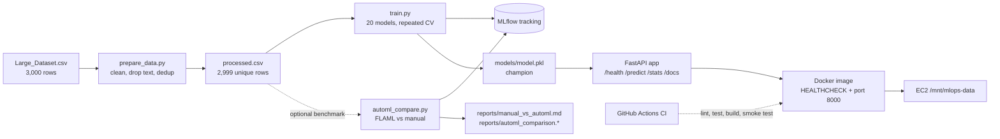

# Graduate Admission Prediction

End-to-end MLOps project: a reproducible training pipeline that compares 20
models, benchmarks bounded AutoML (`FLAML`) against manual champions, tracks
every run in MLflow, serves predictions and runtime metrics through a
containerized FastAPI service, and is verified by CI on every push.

**Task:** predict whether an applicant is admitted (`Chance of Admit >= 0.75`)
from seven academic features.

## Architecture



## Dataset

Extended Graduate Admissions dataset (`data/Large_Dataset.csv`): 3,000 raw
records reduced to **2,999 unique records** in `data/processed.csv` after
dropping `Serial No.`, dropping `Motivation Letter` (to preserve the 7-feature
numeric `/predict` contract), and deduplicating on the 7 academic features:
`GRE Score`, `TOEFL Score`, `University Rating`, `SOP`, `LOR`, `CGPA`,
`Research`. `Chance of Admit` is only used to build the binary `target` label
(`>= 0.75`); it is never a model input. The dataset has no time column.
(The original 400-row `data/Admission_Predict.csv` is retained in `data/` for
reference.)

## Quick start

Requires Python 3.12 and `git`.

```bash
git clone https://github.com/aleshbathegreat/mlops_project.git
cd mlops_project
git checkout main
python3.12 -m venv venv
# Linux / macOS:
source venv/bin/activate
# Windows (PowerShell/CMD):
# venv\Scripts\activate
pip install -r requirements.txt

python src/prepare_data.py
python src/train.py
pytest tests/ -v
uvicorn src.app:app --host 0.0.0.0 --port 8000
```

Then open http://127.0.0.1:8000/docs. Training takes one to three minutes and
creates `models/model.pkl` and `mlflow.db` locally; both are git-ignored.

To browse MLflow experiments locally:

```bash
mlflow ui --backend-store-uri sqlite:///mlflow.db
```

To run the bounded AutoML vs. manual comparison on demand (20-second budget):

```bash
python src/automl_compare.py --time-budget 20
```

### Frontend Dashboard (`dashboard/index.html`)

A zero-dependency interactive dashboard is included in
[dashboard/index.html](dashboard/index.html) for live `/health` and `/stats`
monitoring, interactive `/predict` testing with presets and live `cURL`
generation, and viewing the 2,999-record AutoML vs. manual benchmark summary.

Serve it locally (or open the file directly in a browser) while the API is
running locally or on EC2:

```bash
python -m http.server 3000 --directory dashboard
```

Then open http://127.0.0.1:3000 and set the **API Base URL** bar to
`http://127.0.0.1:8000` (local) or `http://<EC2_PUBLIC_IP>:8000` (EC2).

## API & Monitoring

| Endpoint | Method | Purpose |
|---|---|---|
| `/health` | GET | Liveness/readiness check; returns `{"status": "ok"}` |
| `/predict` | POST | Validates input with Pydantic and returns `admitted` (`0`/`1`) and `probability` |
| `/stats` | GET | Thread-safe service metrics: `total_requests`, `predict_requests`, `avg_latency_ms`, `uptime_seconds` |
| `/docs` | GET | Interactive Swagger / OpenAPI documentation |

Every HTTP request passes through thread-safe middleware (`threading.Lock` +
`time.perf_counter()`) that updates request counters, tracks average latency in
milliseconds, and logs structured key-value events to stdout via the
`admission_api` logger:

- `event=startup` / `event=shutdown`: model path, model class, and readiness status
- `event=request`: `method`, `path`, `status`, and `latency_ms` for every HTTP call
- `event=prediction`: `admitted`, `probability`, and key applicant features on `/predict`
- `event=validation_error` / `event=error`: HTTP `422` schema failures and unhandled exceptions

Inputs are validated with Pydantic (for example GRE `260-340`, TOEFL `0-120`,
CGPA `0-10`). Out-of-range or wrongly typed values return HTTP `422`.

### Ready-to-run `cURL` examples

Set `BASE_URL` to your EC2 public endpoint or local server:

```bash
export BASE_URL="http://<EC2_PUBLIC_IP>:8000"
# Or locally: export BASE_URL="http://127.0.0.1:8000"

# 1. Health check
curl -fsS "${BASE_URL}/health" && echo

# 2. Baseline monitoring stats
curl -fsS "${BASE_URL}/stats" && echo

# 3. Run a prediction
curl -fsS -X POST "${BASE_URL}/predict" \
  -H "Content-Type: application/json" \
  -d '{
    "gre": 320,
    "toefl": 110,
    "university_rating": 4,
    "sop": 4.0,
    "lor": 4.0,
    "cgpa": 9.0,
    "research": 1
  }' && echo

# 4. Verify request counters incremented and avg_latency_ms updated
curl -fsS "${BASE_URL}/stats" && echo
```

## Deployment & Operations (Docker + EC2)

### Local Docker build and run

```bash
docker build -t admission-api .
docker run -d --name admission-api -p 8000:8000 admission-api
docker ps --filter "name=admission-api"
```

The `Dockerfile` prepares the dataset (`src/prepare_data.py`) and trains the
manual champion (`src/train.py`) during build time so the image does not depend
on committed `.pkl` files and does not run slow AutoML searches on build. Its
built-in `HEALTHCHECK` probes `http://127.0.0.1:8000/health` every 30s so
`docker ps` reports `(healthy)`.

### EC2 deployment & Runbook

On an EC2 instance, the container is served on port `8000` (`-p 8000:8000`)
and can optionally mount a persistent EBS volume at `/mnt/mlops-data` for
datasets, trained model artifacts, MLflow SQLite tracking, and comparison
reports.

- **Live endpoint pattern:** `http://<EC2_PUBLIC_IP>:8000` (`/health`,
  `/predict`, `/stats`, `/docs`).
- **Cost control note:** The EC2 instance may be stopped/shut down after
  grading to conserve AWS student credits and can be brought back up or rolled
  back at any time using [RUNBOOK.md](RUNBOOK.md).
- **Operations guide:** See [RUNBOOK.md](RUNBOOK.md) for copy-pasteable
  commands covering immutable image tagging, EC2 `/mnt/mlops-data` mounts,
  post-deploy verification, and rollback to a previous known-good tag.

## Model comparison (Manual 20-model benchmark)

`src/train.py` evaluates 20 configurations across 8 families (baselines, logistic
regression, trees, SVM, KNN, small neural network, ensembles) using 5-fold
stratified cross-validation repeated 3 times (15 scores per model). On the
current **2,999-record** dataset, the 80/20 stratified split produces `2,399`
training rows and `600` sealed test rows (scored once for reporting only).

**Selection rule:** best full-feature model by mean CV F1, then the simplest
model within one standard deviation of it. Baselines (`dummy`, `cgpa_only`) are
reference points and cannot be champions.

**Initial 400-row Milestone 1 baseline & findings** *(earlier `Admission_Predict.csv`, 320 train / 80 test)*:

- **Milestone 1 champion:** `logreg_C10` (logistic regression, `C=10`), CV F1 `0.851 (+/- 0.037)`,
  test F1 `0.841`, test ROC-AUC `0.954`.
- Every real model scored `0.80-0.86` CV F1 (vs. `0.41` for a stratified random guesser),
  with the top ten models within one standard deviation of each other and `CGPA` alone
  scoring `0.857`.
- Test scores on 80 rows were noisy (two MLPs scored `0.90` and `0.72`), which is
  why champion selection relies on repeated cross-validation rather than the
  test split. The current pipeline runs on **2,999 unique records** (`2,399` train / `600` test),
  summarized in the Project Focus section below.

## Project Focus: AutoML (`FLAML`) vs. Manual Training Comparison

### 1. Why this focus fits

On the original 400-row dataset, the top 10 manual models fell within 1 standard
deviation and a single-feature `CGPA` baseline matched multi-feature models.
Scaling to **2,999 unique records** (`data/Large_Dataset.csv` after
deduplication) lets us test whether bounded automated machine learning
(`FLAML`) meaningfully outperforms our curated 20-model manual pipeline
(`src/train.py`) once enough samples exist to separate linear and non-linear
decision boundaries.

### 2. Comparison protocol & metrics

Both pipelines use an identical, leak-free 80/20 stratified split (`2,399`
train / `600` sealed test) and `RepeatedStratifiedKFold(n_splits=5, n_repeats=3)`:

- **5-seed benchmark** ([reports/manual_vs_automl.md](reports/manual_vs_automl.md)):
  Compares the 20-model manual suite (`src/train.py`, including RBF `SVC` and
  ensembles) against `FLAML` `AutoML` at `15s` and `60s` budgets across 5 seeds,
  tracking mean test `ROC-AUC`, wall-clock / developer time, and seed win rate.
- **Single-seed detailed comparison** ([src/automl_compare.py](src/automl_compare.py)):
  Logs `cv_f1_mean`, `cv_f1_std`, `test_f1`, `test_roc_auc`, `train_time_sec`,
  and `inference_latency_ms` to MLflow (`admission-automl-comparison`) and
  exports [reports/automl_comparison.md](reports/automl_comparison.md) and
  [reports/automl_comparison.json](reports/automl_comparison.json).

### 3. Current benchmark results (2,999 records)

**5-seed study summary:**

| Approach | Compute / Search Budget | Mean Test ROC-AUC | Wins vs. Manual (5 Seeds) |
|---|---|---|---|
| Manual 20-model pipeline (`src/train.py`) | `257s` manual compute (wall-clock, no search budget) | **0.9630** | Baseline |
| FLAML AutoML (`15s` budget) | `15s` budget / `16s` dev time | `0.9557` | `0 / 5` |
| FLAML AutoML (`60s` budget) | `60s` budget / `61s` dev time | `0.9603` | `1 / 5` |

**Single-seed `automl_compare.py --time-budget 20` snapshot:**

| Model | Method | Best Estimator | CV F1 (mean +/- std) | Test F1 | Test ROC-AUC | Train Time (s) | Inference Latency (ms/sample) |
|---|---|---|---|---|---|---|---|
| `logreg_C10` | manual_champion | `logreg` | `0.9485 +/- 0.0094` | `0.9458` | `0.9347` | `0.0030` | `0.1877` |
| `cgpa_only_logreg` | manual_baseline | `cgpa_only` | `0.9277 +/- 0.0087` | `0.9262` | `0.8997` | `0.0024` | `0.5520` |
| `flaml_automl` | automl | `lgbm` | `0.9558 +/- 0.0068` | `0.9570` | `0.9612` | `20.1079` | `0.7120` |

**Takeaway:** Across 5 seeds on 2,999 records, the manual 20-model pipeline
(`0.9630` ROC-AUC in `257s` manual compute) outperforms bounded FLAML: at `15s`
(`16s` dev time), FLAML achieves `0.9557` ROC-AUC with `0/5` wins and a paired
delta of `-0.0073 +/- 0.0044`; at `60s` (`61s` dev time), FLAML reaches `0.9603`
ROC-AUC with `1/5` wins and a paired delta of `-0.0027 +/- 0.0025` (the single
win at `60s` barely crossed by `0.0002`). FLAML trails mainly because its
default estimator space lacks kernel **SVM** (`SVC`), which fits this 7-feature
numeric boundary well, making AutoML ideal for rapid baseline discovery while
the manual pipeline remains preferable for final model selection.

### 4. Next steps toward the final demo

- Explore probability calibration and decision-threshold sensitivity on the
  manual champion vs. AutoML candidates.
- Simulate shifted/out-of-range applicant traffic against the deployed EC2
  service and observe live `/stats` latency, request counts, structured logs,
  and HTTP `422` validation behavior.
- Finalize the live EC2 + MLflow demo walkthrough for final evaluation.

## Tests and CI

`pytest` runs 15 tests across two test modules:

- [tests/test_app.py](tests/test_app.py) (13 tests): `/health`, `/predict`
  (valid, wrong-type `422`, out-of-range `422`), `/stats` schema and request
  counter/latency tracking, structured logging (`startup`/`shutdown`, `request`,
  `prediction`, `validation_error`, `error`), model loading, and `prepare_data`
  validation on `data/Large_Dataset.csv` (2,999 unique records).
- [tests/test_automl_compare.py](tests/test_automl_compare.py) (2 tests): CLI
  argument parsing and fast (`--time-budget 2`) end-to-end AutoML comparison
  using isolated temporary outputs and MLflow DB.

GitHub Actions ([.github/workflows/ci.yml](.github/workflows/ci.yml)) runs separate
`lint` (`ruff check .`, `ruff format --check .`), `test` (`prepare_data.py`,
`train.py`, `pytest tests/ -v`), and `docker` (gated on `lint` and `test`,
building the image and smoke-testing `/health`, `/stats`, and `/predict`) jobs
on every push and pull request to `main` and `milestone_1`.

## Project structure

```text
src/prepare_data.py          data cleaning and validation
src/train.py                 20-model comparison, MLflow logging, champion selection
src/automl_compare.py        bounded FLAML AutoML vs. manual benchmark + MLflow/reports
src/app.py                   FastAPI service (/health, /predict, /stats, /docs)
dashboard/index.html         zero-dependency interactive monitoring & prediction dashboard
tests/test_app.py            API, monitoring, and data validation tests
tests/test_automl_compare.py fast AutoML comparison unit tests
reports/                     AutoML vs. manual comparison Markdown and JSON reports
Dockerfile                   reproducible container image with HEALTHCHECK
.dockerignore                build context exclusions
.github/workflows/ci.yml     GitHub Actions lint, test, and Docker smoke-test pipeline
RUNBOOK.md                   build, redeploy, EC2 /mnt/mlops-data, verification, and rollback guide
CONTRIBUTION.md              team task breakdown and reflections
AI_USAGE.md                  AI tool usage and human review disclosure
```

## Limitations

- Even with 2,999 unique records, the dataset has no time dimension, so
  behaviour under new data is studied by simulation rather than real arrivals.
- `Motivation Letter` is dropped in `src/prepare_data.py` to preserve the
  7-feature numeric `/predict` contract; incorporating text features would
  require updating the API schema.

## Team

See [CONTRIBUTION.md](CONTRIBUTION.md) (including estimated Milestone 2 effort of
~12 hours each for Aleshba Tariq and Syed M Abdullah Yousuf). AI tool usage is
documented in [AI_USAGE.md](AI_USAGE.md).
